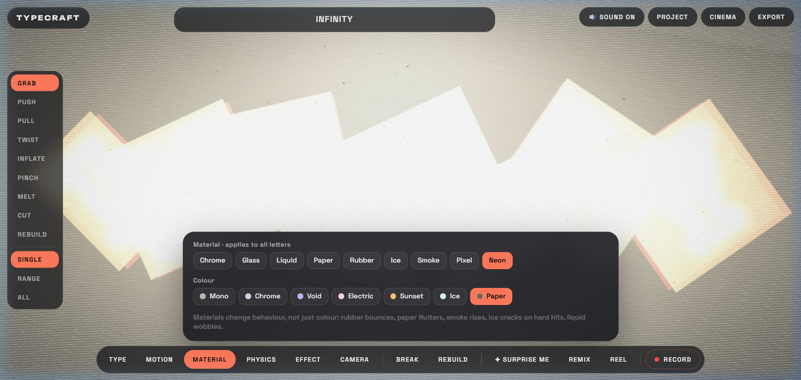

<div align="center">

# TYPECRAFT
### Shape words. Break rules. Kinetic typography in physical 3D space.

[](LICENSE)
[](https://threejs.org/)
[](https://developer.mozilla.org/en-US/docs/Web/API/Web_Audio_API)
[](https://github.com/TejaPriyan/Typecraft)
[](https://github.com/TejaPriyan/Typecraft)

<br/>



<br/>

**[Launch Live Studio](https://tejapriyan.github.io/Typecraft/)**

</div>

---

## About Typecraft

**Typecraft** is a browser-native kinetic typography playground and real-time motion graphics studio. It treats text not as flat glyphs, but as tangible physical objects in 3D space with mass, restitution, friction, spring memory, and aerodynamic drag.

Type any word, phrase, or slogan, then physically grab, throw, inflate, twist, shatter, and melt letters. Animate them with kinetic physical forces (*Gravity, Magnet, Orbit, Wind, Float, Chaos*), synchronize them to musical beats, record your performance, and render directly to video, animated GIF, high-res transparent PNG, or clean vector SVG.

### Core Philosophy
* **Zero Backend, Zero Accounts**: Everything runs 100% locally in your web browser. No accounts, no subscriptions, and no cloud rendering queues.
* **Complete Privacy**: Your typography, custom fonts, audio tracks, and exported assets never leave your computer.
* **Instant Creative Flow**: Low latency, immediate feedback loop, responsive touch and mouse sculpt tools, and instant render pipelines.

---

## Key Features

### 🖋️ 3D Typography & Custom Font Ingestion
* **Real-time 3D Extrusion**: Procedurally converts glyph contours into variable-depth 3D meshes with customizable bevels and edge treatments.
* **Curated Font Roster**: Includes 15 pre-configured typography families spanning Display, Serif, Clean Sans, Monospace, and Experimental (Unbounded, Anton, Syne, Fraunces, Space Grotesk, JetBrains Mono, Bungee, Climate Crisis, and more).
* **✦ Custom Font Upload**: Drag and drop or upload your own `.ttf`, `.otf`, `.woff`, or `.woff2` font files to instantly sculpt with custom brand typography.

### 🛠️ Physical Sculpting Tools
Interact directly with letter meshes using specialized vertex deformers:
* **Grab**: Pick up individual letters, fling them across the viewport, or bounce them against screen bounds.
* **Push / Pull**: Displace letter geometry inward or outward with dynamic spring tension.
* **Twist**: Apply rotational torque around vertices for organic spiraling typography.
* **Inflate / Pinch**: Bulge letters into pillowy volumes or constrict them at focal points.
* **Melt**: Cause letter contours to sag and puddle under simulated thermal gravity.
* **Cut & Rebuild**: Slice typography into pieces or restore deformed glyphs back to their original geometric rest state.

### 💎 Physically-Inspired GLSL Shaders
Every material features customized vertex displacement, reflection, refraction, and optical characteristics:
* **Chrome**: Polished mirror reflections with environmental Fresnel and dynamic lighting highlights.
* **Glass**: Translucent refractive glass with chromatic dispersion.
* **Liquid**: Surface wobble, ripple harmonics, and fluid elasticity.
* **Neon**: Saturated luminescence with soft atmospheric bloom.
* **Rubber**: High restitution, soft-body wobbling, and friction.
* **Paper**: Low mass, aerodynamic flutter, and subtle edge curl.
* **Ice**: Crystalline scattering, brittle fractures, and sliding friction.
* **Smoke**: Volumetric particulate dissipation and negative buoyant lift.
* **Pixel**: Retro dither shading with discretized stepped lighting.

### 🎵 Procedural Audio & Beat Synchronization
* **Dynamic Synthesizer**: Native Web Audio API synthesis produces tactile audio feedback for letter collisions, dragging friction, bounces, and glass shatter effects.
* **Beat Audio Sync**: Load custom music tracks (`.mp3`, `.wav`, `.ogg`, `.m4a`) to trigger automated kinetic letter pulses and camera movements synced directly to the rhythm.

### 🎬 Timeline, Recording & Cinema Mode
* **Live Take Recording**: Record continuous interactive sessions with full timeline scrubbing, loop toggling, and reverse playback.
* **Cinema Mode**: Distraction-free full-viewport showcase featuring cinematic letterboxing and gentle camera choreography.
* **Particle Text System**: Dissolve words into thousands of reactive particles that swirl, repel, attract, or morph seamlessly between two distinct words.

---

## Multi-Format Export Pipeline

Typecraft renders all outputs directly inside the browser using client-side WebGL frame capture:

| Format | Aspect Ratios | Ideal Use Case |
| :--- | :--- | :--- |
| **MP4 / WebM Video** | 9:16 (Reels/TikTok), 16:9 (Landscape), 1:1 (Square) | Social media motion graphics, title sequences, music video intros |
| **Animated GIF** | 9:16, 16:9, 1:1 (Optimized 3–5s loops) | Discord reactions, newsletters, website embeds |
| **High-Res PNG** | Alpha transparency option at full canvas resolution | Print design, key art, branding posters, merchandise |
| **Vector SVG** | Clean geometric outlines of current letter positions | Vector illustration, logo ideation, laser cutting & plotter prep |

---

## Interactive Controls & Shortcuts

| Action | Control / Shortcut |
| :--- | :--- |
| **Select / Grab Letter** | Left Click + Drag |
| **Trigger Impact Shockwave** | <kbd>Space</kbd> or Click Empty Space |
| **Break Letters into Particles** | <kbd>B</kbd> |
| **Rebuild Letters** | <kbd>R</kbd> |
| **Switch Sculpt Tool** | Keys <kbd>1</kbd> through <kbd>9</kbd> |
| **Toggle Sound** | Sound button in top bar |
| **Upload Custom Font** | Drag & drop `.ttf`/`.otf` file or click **+ Upload Font** in TYPE panel |
| **Load Beat Track** | Click **🎵 Beat** in top bar or drop audio file |
| **Exit Modals / Cinema** | <kbd>Esc</kbd> |

---

## Technical Architecture

```
Typecraft/
├── index.html            # Production bundle (single self-contained HTML file)
├── preview.png           # Visual social preview
├── robots.txt            # Search engine & crawler directives
├── sitemap.xml           # XML sitemap
├── LICENSE               # MIT License
├── README.md             # Documentation
└── src/
    ├── head.html         # Head metadata, styles, and initial DOM layout
    ├── build.py          # Minimal build script concatenating modules
    └── js/
        ├── 00_core.js     # State store, math utilities, easing, and constants
        ├── 10_audio.js    # Procedural Web Audio API sound & beat engine
        ├── 20_glyphs.js   # 2D canvas font rasterizer, SDFs, and contour extraction
        ├── 30_shaders.js  # GLSL vertex & fragment shader material library
        ├── 40_scene.js    # Three.js viewport, camera, and post-processing passes
        ├── 50_letters.js  # Extruded 3D letter meshes and deformation buffers
        ├── 60_physics.js  # Numerical physics integration (Euler/Verlet)
        ├── 70_particles.js# GPU particle text, dust, and sparks
        ├── 80_input.js    # Raycasting, pointer tracking, and sculpt brushes
        ├── 85_motion.js   # Kinetic animation presets and motion drivers
        ├── 90_timeline.js # Timeline scrubber, keyframe recording, and playback
        ├── 95_export.js   # Video MediaRecorder, GIF, PNG, and SVG vector encoders
        ├── 97_storage.js  # Client-side IndexedDB project persistence
        ├── 98_ui.js       # Glassmorphism studio HUD and dialog controls
        ├── 99_main.js     # Animation tick loop and performance auto-scaler
        └── 99_end.js      # Module closure terminator
```

---

## Hosting on GitHub Pages

1. Navigate to your repository settings on GitHub (**Settings** > **Pages**).
2. Under **Build and deployment > Source**, select **Deploy from a branch**.
3. Set the branch to `main` and folder to `/ (root)`, then click **Save**.
4. Your kinetic typography playground will be live at `https://<username>.github.io/<repo-name>/`.

---

## License

Created by [Teja Priyan](https://github.com/TejaPriyan). Distributed under the [MIT License](LICENSE).
